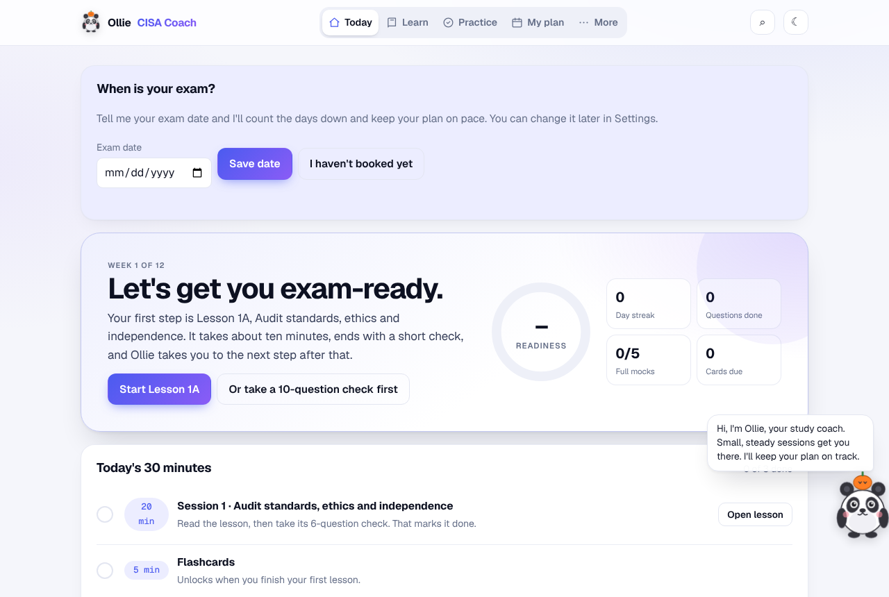
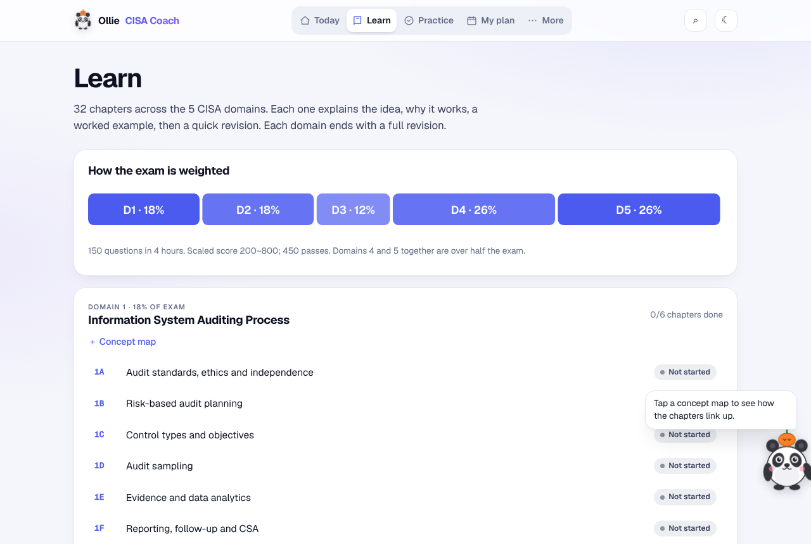
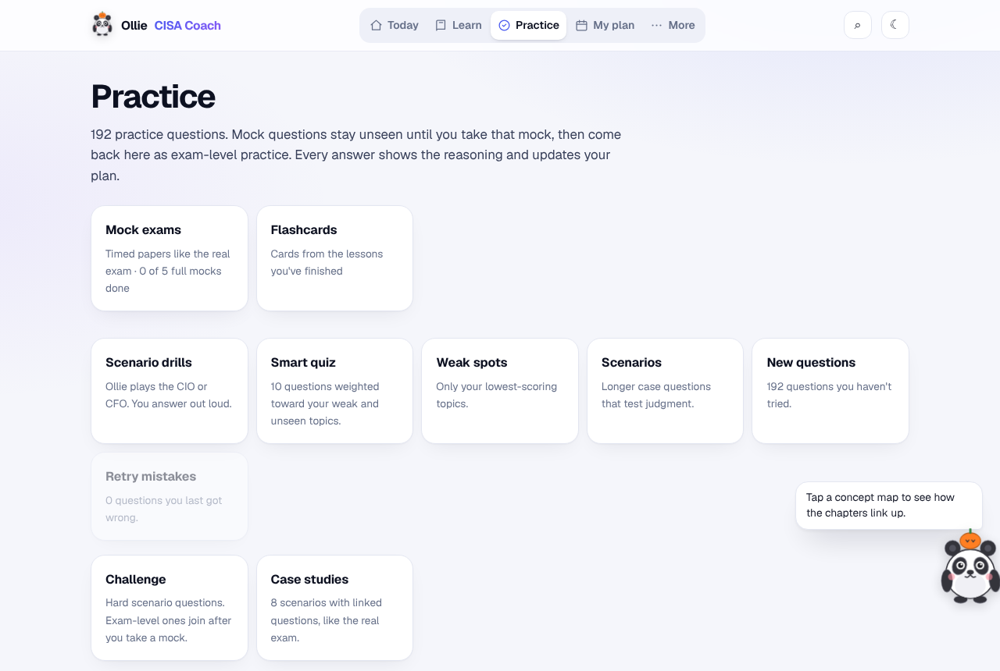
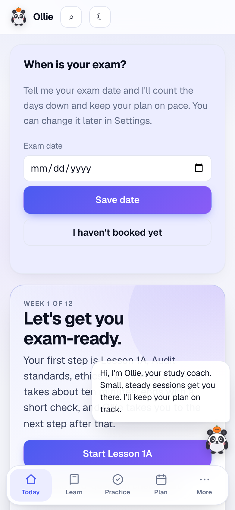
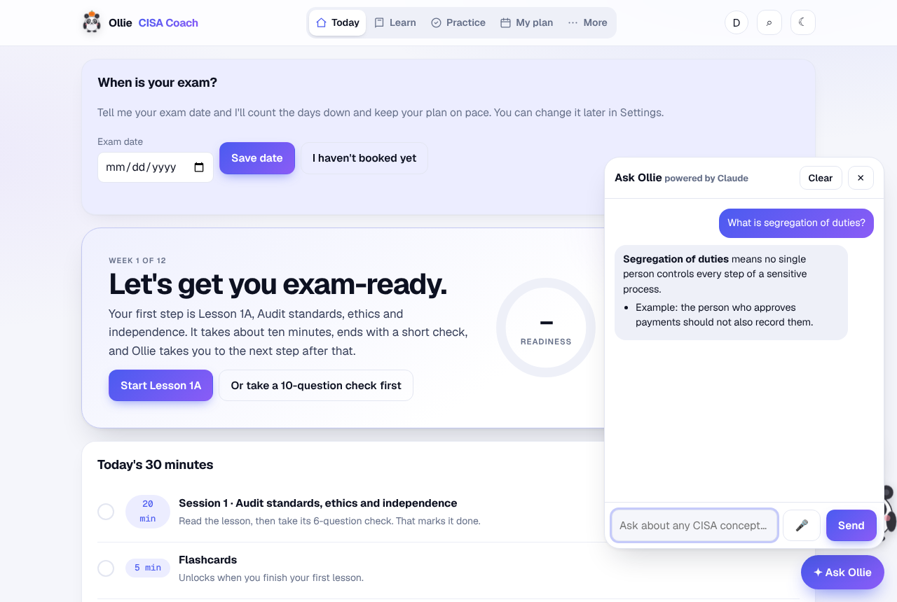

# Ollie CISA Coach

A friendly, free study coach for the **ISACA CISA exam**: short lessons, quizzes, full mock exams, spaced-repetition flashcards, animated explainers and a 12-week plan, guided by Ollie the panda.

**Open it now:** https://amilwani.github.io/ollie/ (no sign-up; your progress stays in your browser)



> Ollie is an independent study aid. It is not affiliated with, endorsed by or sponsored by ISACA. CISA® and ISACA® are registered marks of ISACA. All lessons and questions are original; check isaca.org for official exam rules.

## Two ways to use it

| | **Public link (GitHub Pages)** | **Your own server (self-hosted)** |
|---|---|---|
| Cost | Free | A small server, about $5/month, plus a domain |
| Setup | None | About an hour, guided ([docs/SELF_HOSTING.md](docs/SELF_HOSTING.md)) |
| All lessons, quizzes, mocks, flashcards, plan | ✅ | ✅ |
| Works offline, installs like an app | ✅ | ✅ |
| Progress saved | In this browser | In your Google account, synced across devices |
| Sign in with Google | | ✅ |
| Study-buddy leaderboard (opt-in) | | ✅ |
| **Ask Ollie** AI tutor, explain in another language, new practice questions | | ✅ with your own Anthropic API key ([docs/AI_SETUP.md](docs/AI_SETUP.md)) |
| Admin dashboard, backups, data export and account deletion | | ✅ |

## Screenshots

| Learn | Practice | Phone |
|---|---|---|
|  |  |  |

Self-hosted, with the AI tutor turned on:



## Install it like an app

Open the link, then:

- **iPhone / iPad (Safari):** Share → **Add to Home Screen**.
- **Android (Chrome):** menu ⋮ → **Install app** (or **Add to Home screen**).
- **Windows / Mac (Chrome or Edge):** the install icon at the right end of the address bar.

After the first visit it works offline.

## Deploy on Vercel

Free hosting with Google sign-in, synced progress and the leaderboard, no server to look after.
Import this repository at [vercel.com/new](https://vercel.com/new), add a Turso database from the Vercel Marketplace and set `SESSION_SECRET`.
Step by step: [docs/VERCEL.md](docs/VERCEL.md).

## Self-hosting in short

```bash
git clone https://github.com/amilwani/ollie && cd ollie
cp .env.example .env          # fill in your domain, Google client ID, session secret
# put your domain in Caddyfile, then:
docker compose up -d --build  # HTTPS certificates are automatic
```

Step-by-step instructions, including Google sign-in setup and a no-Docker option: [docs/SELF_HOSTING.md](docs/SELF_HOSTING.md) · [docs/GOOGLE_SETUP.md](docs/GOOGLE_SETUP.md) · [docs/AI_SETUP.md](docs/AI_SETUP.md) · [docs/CHECKLIST.md](docs/CHECKLIST.md). A printable guide is in [docs/Ollie-Hosting-Guide.pdf](docs/Ollie-Hosting-Guide.pdf).

Try it locally without any Google setup:

```bash
npm install
npm run dev        # http://localhost:3000, with a test-only "Dev sign-in" button
```

## How the repository is laid out

| Path | What it is |
|---|---|
| `app-source/cisa-coach.html` | The coach itself: one self-contained page. Edit or replace this to update content. |
| `public/` | What the server serves: `index.html` (built from the app), `claude-shim.js` (sign-in, sync, leaderboard, AI), PWA files, privacy/terms templates, admin page. |
| `server/` | Node/Express API: Google sign-in, sessions, progress sync, leaderboard, AI proxy, admin, rate limits, security headers. SQLite storage. |
| `pages/` | The small layer used for the GitHub Pages copy (no server). |
| `scripts/` | `import-app.js` (app → `public/index.html`), `build-pages.js` (app → `_site/`), `backup.js`, tests. |
| `.github/workflows/` | Runs tests on every change and publishes the Pages copy from `main`. |

### Updating the app content

```bash
npm run import-app -- app-source/cisa-coach.html   # refresh the self-hosted page
npm test                                            # backend tests
git commit -am "Update coach" && git push           # GitHub Pages republishes itself
```

## Privacy

- **Public link:** no account, no analytics, no ads. Progress lives in your browser's storage. See [pages/privacy.html](pages/privacy.html).
- **Self-hosted:** only what is needed for sign-in and sync; members can export or delete their data at any time. AI questions go to Anthropic only when the tutor is switched on and used. Template notice: [public/privacy.html](public/privacy.html). Have it reviewed for your country before going public.

## License

Code and original content: [MIT](LICENSE). The CISA and ISACA names are trademarks of ISACA and are used only to describe what the app helps you study.
